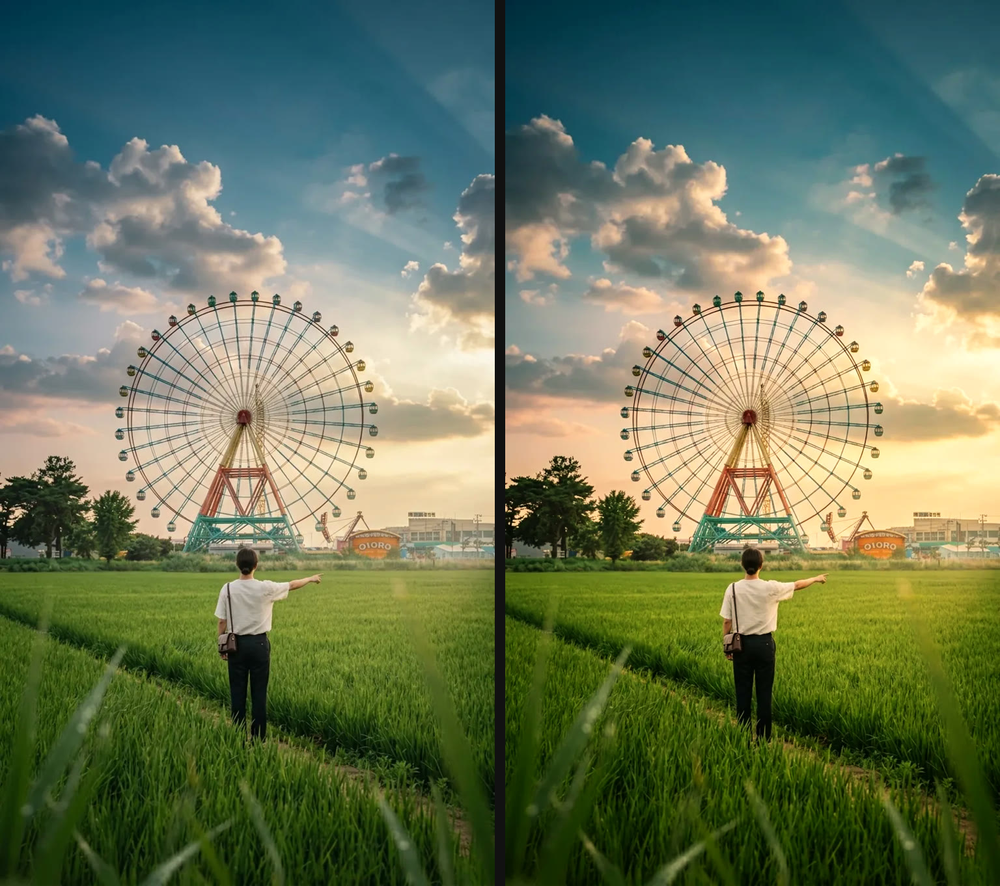
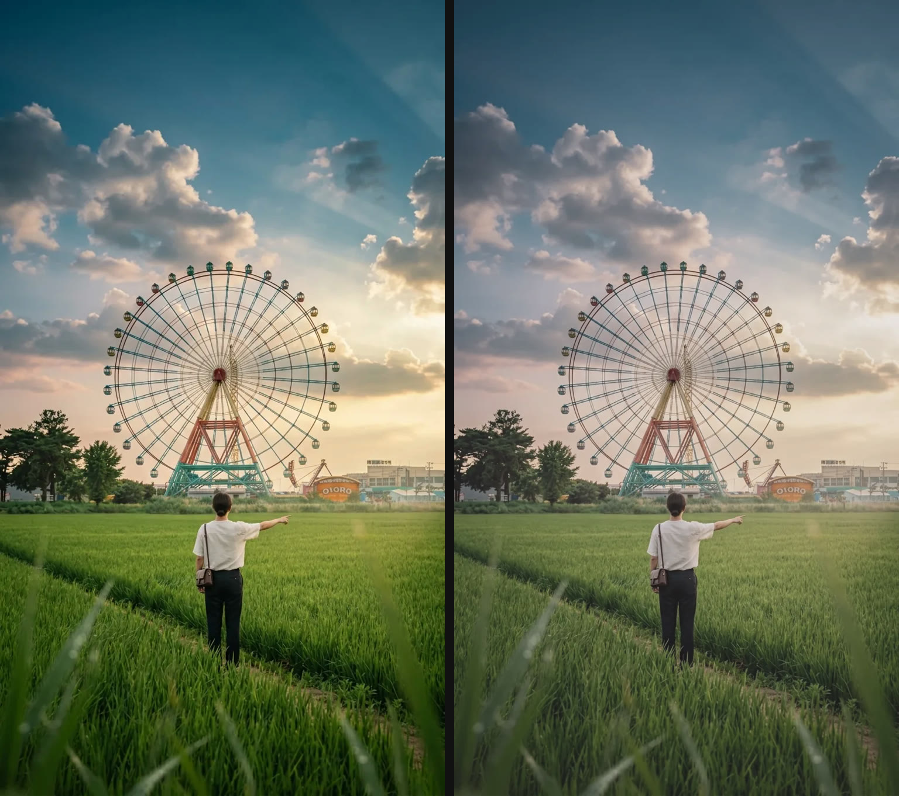
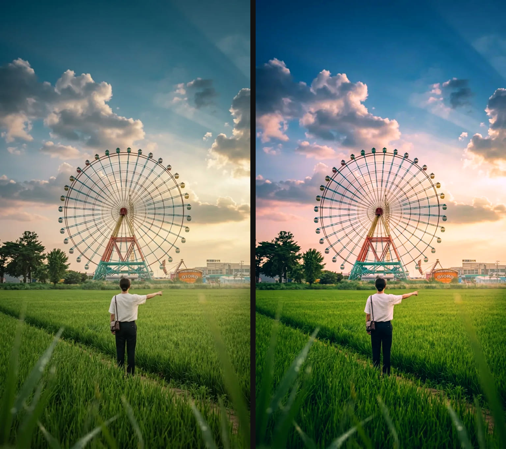
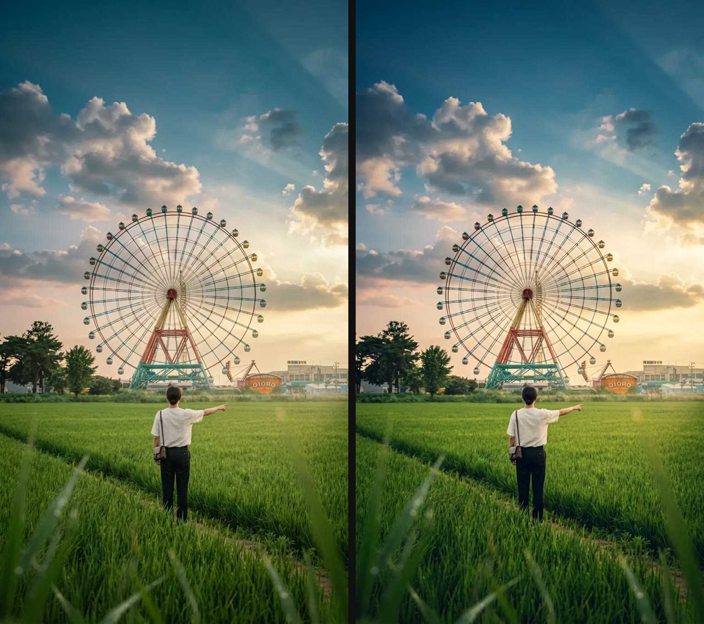
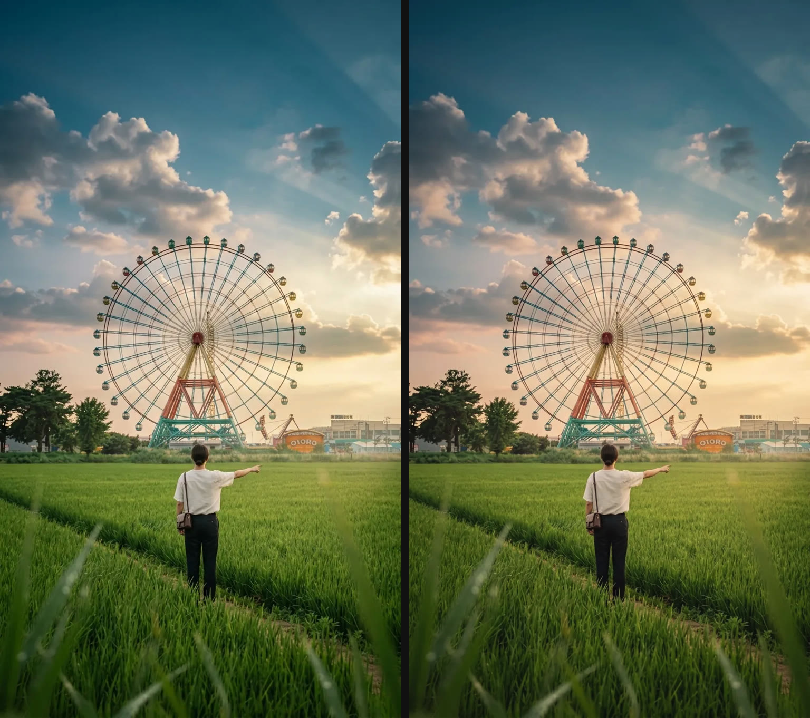

# slay LUTs — 5 free cinematic LUTs (.cube)

[](LICENSE)
[](https://www.slaycamera.com/?utm_source=github&utm_medium=repo&utm_campaign=luts)

Five original cinematic LUTs from **slay** — the composition-guide camera for iPhone.
Free to use in personal and commercial work under [CC BY 4.0](LICENSE): just credit
**slay — [slaycamera.com](https://www.slaycamera.com/?utm_source=github&utm_medium=repo&utm_campaign=luts)**.

`.cube` 3D LUTs (33×33×33) that load into CapCut, DaVinci Resolve, Adobe Premiere Pro,
Final Cut Pro, Photoshop, After Effects and Affinity Photo.

```bash
git clone https://github.com/slaycamera/luts.git
```

Or grab individual files from [`luts/`](luts/).

## The looks

Left: original photo · Right: LUT applied.

### 1 · slay Amber — golden-hour glow



Warm highlights, gentle contrast, a touch of sunset in the sky.
Best for golden hour, travel and outdoor portraits.
→ [`luts/slay-01-amber.cube`](luts/slay-01-amber.cube)

### 2 · slay Fade — matte film fade



Lifted blacks, muted colour, soft highlights — the classic faded-film base.
Best for moody stills, film-emulation starters and subtle grading.
→ [`luts/slay-02-fade.cube`](luts/slay-02-fade.cube)

### 3 · slay Neon — night-city punch



Cyan shadows, magenta highlights, extra colour and contrast.
Best for city lights, neon signs and night photography.
→ [`luts/slay-03-neon.cube`](luts/slay-03-neon.cube)

### 4 · slay Film — classic filmic



Deep contrast, teal shadows, warm skin tones — a timeless filmic look.
Best for everyday photos, portraits and video.
→ [`luts/slay-04-film.cube`](luts/slay-04-film.cube)

### 5 · slay Portrait — soft and flattering



Warm skin, gentle contrast, a soft roll-off in the highlights.
Best for people, selfies and close-ups.
→ [`luts/slay-05-portrait.cube`](luts/slay-05-portrait.cube)

## How to install

**CapCut (desktop & mobile)** — open a clip, go to *Adjust*, find the *LUT* section
and choose *Import*, then select the `.cube` file. On mobile, LUT import is available
in recent versions of the app.

**DaVinci Resolve** — Color page → right-click a node → *LUT* → *Browse…* and pick
the `.cube`. To keep it in the menu, copy the file to
`~/Library/Application Support/Blackmagic Design/DaVinci Resolve/LUT` (macOS) or
`%APPDATA%\Blackmagic Design\DaVinci Resolve\Support\LUT` (Windows).

**Adobe Premiere Pro** — Lumetri Color → *Basic Correction* → *Input LUT* → *Browse*
and select the `.cube`.

**Final Cut Pro** — copy the `.cube` to
`~/Library/Application Support/Final Cut Pro/Custom LUTs/` (create the folder if it
does not exist), then apply the *Custom LUT* effect to a clip.

**Photoshop** — Layer → New Adjustment Layer → *Color Lookup* → *3D LUT* → *Load 3D LUT*.

**After Effects** — Effect → Color Correction → *Apply Color LUT* and choose the file.

**Affinity Photo** — Adjustment → *LUT* → *Load LUT*.

**iPhone / iPad** — Photos and Lightroom mobile do not load `.cube` files. For LUTs
live on your camera viewfinder, use the slay app.

## FAQ

**Are these LUTs really free?**
Yes. CC BY 4.0 — free for personal and commercial use, including client work.
The only condition is credit (see below).

**Can I share or repack them?**
Yes, with attribution to slay. You may not claim them as your own or sell the files
as-is.

**Do they work on video?**
Yes — anywhere 3D `.cube` LUTs are supported, including every app listed above.

**Do they work in Lightroom?**
Lightroom does not load `.cube` files. Use Photoshop, Affinity Photo or DaVinci
Resolve, or apply them live in the slay app on iPhone.

**Are these the same LUTs as in the app?**
This is a free starter pack of five original slay looks built for desktop editors.
The slay iPhone app ships its own 38-look library.

## Attribution

When you publish work that uses these LUTs, add:

> LUTs: [slay](https://www.slaycamera.com/?utm_source=github&utm_medium=repo&utm_campaign=luts) (CC BY 4.0)

## License

The LUTs in this repository are released under the
[Creative Commons Attribution 4.0 International license](LICENSE) (CC BY 4.0).
You are free to share and adapt them for any purpose, including commercially,
as long as you give appropriate credit to slay.

## More looks

The slay iPhone app packs **38 LUTs** plus 14 live composition guides and its full
article library — available with Slay Pro.

[Download slay on the App Store](https://apps.apple.com/app/id6807513456?utm_source=github&utm_medium=repo&utm_campaign=luts) ·
[slaycamera.com](https://www.slaycamera.com/?utm_source=github&utm_medium=repo&utm_campaign=luts)

## Repo layout

```
luts/       the .cube files
previews/   original · graded preview images
tools/      generator, validator and preview builder
```
